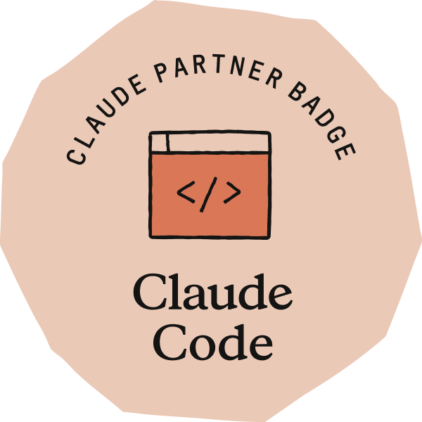

# Hi, I'm Rahul Pal 👋

### Senior Software Engineer | Backend Architecture | Generative AI | Enterprise Modernisation

I'm a Senior Software Engineer with **7+ years of experience** building scalable backend systems, distributed applications and AI-powered solutions.

My engineering journey spans Backend Engineering, Cloud Infrastructure, Enterprise Software and Generative AI. I enjoy solving complex engineering challenges, designing reliable systems and exploring how AI can transform software development.

Currently focused on **AI Engineering, Agentic AI, AI-assisted Software Development and Enterprise System Modernisation**.

---

## 🚀 About Me

- 💻 7+ years of experience in backend and enterprise software engineering.
- ☕ Strong background in Java, Spring Boot, Spring WebFlux and Microservices.
- 🤖 Hands-on experience designing and developing production-grade Generative AI and RAG applications.
- 🧠 Exploring Agentic AI, LLM architectures and AI-assisted software engineering.
- ☁️ Experience with AWS, Docker, Kubernetes, Terraform and CI/CD.
- 🌍 International project collaboration across Australia, the United States, France and Singapore.
- 🇫🇷 Onsite project experience in Paris, France.
- 🌱 Open-source contributor and continuous learner, passionate about engineering innovation.

Currently contributing to an ongoing enterprise technology initiative in the **Media & Entertainment domain**, while exploring AI-driven approaches to software engineering and legacy modernisation.

---

## 🛠️ Technical Skills

### Programming Languages
Java | Python | Go | Rust | JavaScript | TypeScript | C/C++ | SQL

### Backend Engineering
Spring Boot | Spring WebFlux | Spring Cloud | Microservices | FastAPI | REST APIs | GraphQL | R2DBC | WebSockets

### Generative AI & Agentic AI
RAG | LLM Integration | LangChain | LangGraph | OpenAI APIs | Ollama | Prompt Engineering | Embeddings | Vector Databases | AI Orchestration

### Databases
PostgreSQL | pgvector | Redis | SQL

### Cloud & DevOps
AWS | Docker | Kubernetes | Terraform | Jenkins | AWS CodePipeline | Linux | Git | Bitbucket

### Engineering Practices
System Design | Distributed Systems | Reactive Programming | Design Patterns | Test-Driven Development | CI/CD | API Design | Application Security

---

## 🧠 Featured Engineering Projects

### 🧑‍💻 AIDevAssistant – AI-Powered Developer Assistant

Designed an AI-assisted developer workflow to automate and improve the safety of MongoDB database migration development using Liquibase.

The project focuses on bringing structured AI assistance into enterprise development workflows while keeping developers in control of generated changes.

**Key Highlights:**
- Repository-aware requirement analysis and change planning.
- AI-assisted generation of Liquibase MongoDB XML changelogs.
- Specialised AI skills for Liquibase, MongoDB, Spring persistence and testing workflows.
- Automated migration validation using disposable MongoDB Testcontainers.
- Forward migration and rollback validation.
- Readiness assessment with explicit `READY`, `READY_WITH_REVIEW` and `BLOCKED` outcomes.
- Delivery evidence and engineering metrics to improve traceability.
- Human-in-the-loop review before changes are accepted or delivered.

**Architecture & Technologies:**

Java | Spring Boot | MongoDB | Liquibase | Testcontainers | Agentic AI | Repository Skills | AI Developer Workflows

**Engineering Principles:**
- Safe and reviewable AI-generated changes.
- Repository-grounded context instead of invented requirements.
- Automated validation before developer acceptance.
- No unauthorised production database changes or deployments.
- Developer ownership of final commits and releases.

### 🤖 Enterprise RAG & AI Assistant

Designed and developed an AI-powered knowledge assistant for enterprise users.

**Key Highlights:**
- Designed document ingestion and processing pipelines.
- Implemented document chunking and embedding generation.
- Integrated vector databases for semantic search and retrieval.
- Built context-aware LLM integration and backend orchestration.
- Applied prompt engineering, retrieval tuning and response validation.
- Developed AI backend services using FastAPI.

**Tech Stack:** Python, FastAPI, LangChain, LangGraph, OpenAI APIs, Ollama, PostgreSQL, pgvector, Redis, Docker.

### ⚙️ Enterprise Backend & Microservices

Experience designing and developing scalable backend systems for enterprise applications.

**Key Highlights:**
- Developed high-throughput Java microservices.
- Implemented reactive services using Spring WebFlux.
- Built real-time communication using Java WebSockets.
- Optimised database interactions using Spring Data R2DBC.
- Implemented secure multi-tenant authentication.
- Integrated AWS services for asynchronous communication and document management.

**Tech Stack:** Java, Spring Boot, Spring WebFlux, PostgreSQL, AWS, Docker, Terraform, Keycloak.

---

## 🌐 Global Experience & Domain Expertise

Professional engineering experience across **India and Vietnam**, with international project collaboration spanning Australia, New Zealand, France, the United States and Singapore.

- **Australia & New Zealand:** Core product engineering team engagement for an enterprise insurance client, contributing to backend development and application modernisation.
- **France:** Onsite engineering experience in Paris.
- **United States & Singapore:** International project collaboration.

### 🏢 Industry & Domain Experience

- **Insurance:** Insurance platforms and business-critical backend systems.
- **Banking & Financial Services:** Financial technology, enterprise integrations and transaction-oriented systems.
- **Healthcare:** Healthcare interoperability, HL7 FHIR and secure multi-tenant architectures.
- **Media & Entertainment:** Enterprise technology development and service-oriented platforms.
- **E-commerce:** Backend application development and Third party services integrations.

---

## 🌍 Open Source Contributions

I believe in contributing to the developer community, collaborating with engineers and learning through open-source development.

### Eclipse BIRT
Contributed to the Eclipse BIRT open-source reporting and business intelligence project.

🔗 [Explore Eclipse BIRT](https://github.com/eclipse-birt)

### Microsoft WinGet Packages
Contributed to Microsoft's community-maintained Windows Package Manager repository.

🔗 [Explore WinGet Packages](https://github.com/microsoft/winget-pkgs)

🔗 [View My GitHub Contributions](https://github.com/hyrahul)

---

## 🏅 Certifications & Credentials

  
  &nbsp;&nbsp;
  

### Professional Training

- DeepLearning.AI – Generative AI for Software Development.
- Advanced LLMs with Retrieval Augmented Generation (RAG): Practical Projects for AI Applications.

---

## 🎓 Education

**Master of Computer Applications (MCA)**  
ITM Universe, Vadodara, India  
July 2018 | CGPA: 7.80

---

## 🌱 Currently Exploring

- Agentic AI architectures and multi-agent systems.
- AI-assisted legacy code modernisation.
- AI-powered developer tools and coding agents.
- LLM evaluation, reliability and guardrails.
- Production-grade AI infrastructure.
- Advanced system design and distributed architectures.

---

## 🤝 Let's Connect

I'm always interested in connecting with engineers, architects and AI enthusiasts to discuss interesting technical challenges, open-source projects and emerging technologies.

- 💻 GitHub: [@hyrahul](https://github.com/hyrahul)
- 📧 Email: [hyrahulpal@gmail.com](mailto:hyrahulpal@gmail.com)
- 💼 LinkedIn: [Rahul Pal](YOUR_LINKEDIN_URL)

---

  <i>"Building reliable software. Exploring intelligent systems. Contributing to open source. Always learning."</i>

